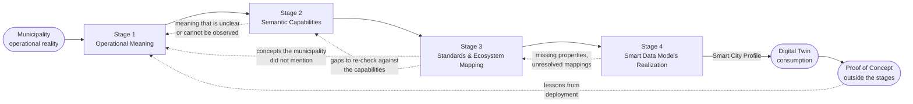
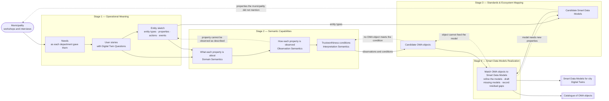
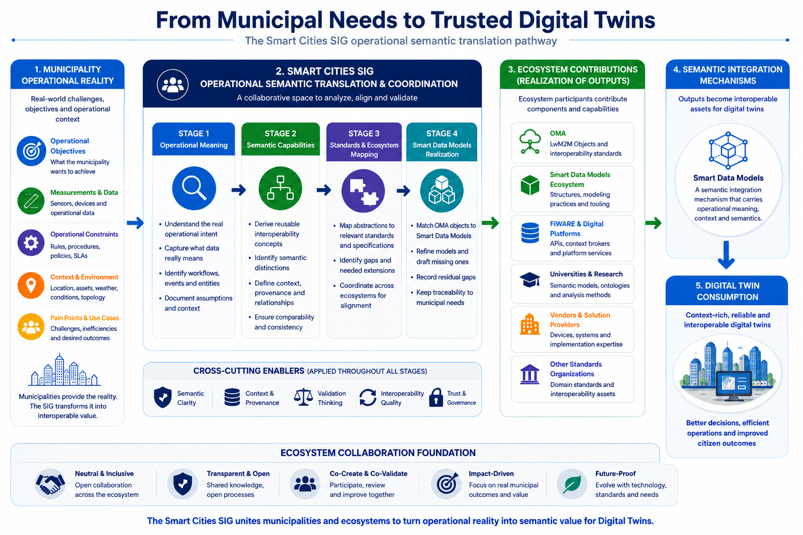

# {{ $doc.title }}

## Introduction

Municipalities are increasingly investing in Digital Twin initiatives to improve the operation, monitoring, optimization, and long-term management of public services such as public lighting, water management and irrigation, environmental monitoring, transportation, and energy management.

However, municipalities often face significant interoperability challenges:
- operational information is fragmented across systems and vendors,
- measurements are interpreted differently,
- contextual information is lost,
- semantic meaning is inconsistent,
- and Digital Twins consume data that may not be sufficiently reliable, contextualized, or comparable.

The Smart Cities SIG was created to help address this challenge.

The SIG provides a collaborative space where municipalities, standards organizations, ecosystem initiatives, universities, vendors, and interoperability experts can jointly analyze municipality operational needs and progressively transform them into semantically reliable interoperability outputs suitable for Digital Twin consumption.

The SIG does not replace existing standards organizations, Smart Data Models ecosystems, or Digital Twin platforms.

Instead, the SIG acts as:
- an operational semantic translation initiative,
- an interoperability coordination space,
- and a collaborative ecosystem alignment mechanism.

The terms used across the methodology are defined in the [Glossary](/methodology/glossary.md).

---

# Why Raw Telemetry Is Not Enough

Raw telemetry alone is insufficient to create a trustworthy and operationally useful Digital Twin.

Digital Twins require more than raw telemetry, disconnected measurements, or isolated device outputs. They require:
- contextual information,
- semantic consistency,
- provenance awareness,
- interoperability reliability,
- and operational meaning preservation.

The methodology therefore treats interoperability and semantic integrity as foundational requirements for trustworthy Digital Twin integration. The specific dimensions of meaning a Digital Twin needs are defined as the [semantic capabilities](/methodology/core-methodology/stage-2-semantic-capabilities.md).

---

# Purpose of the Methodology

The purpose of this methodology is to provide a practical and repeatable approach for transforming municipality operational needs into reusable interoperability understanding.

The methodology focuses on:
- preserving operational meaning,
- identifying semantic distinctions,
- deriving reusable semantic capabilities,
- and coordinating ecosystem realization approaches.

---

# Meaning Before Standards

The methodology's central principle is that **operational meaning is captured before any standard, schema, or architecture is chosen**.

The methodology prioritizes:
1. **understanding the municipality's operational intent:** what each department needs to know or do, about which things, under which conditions, and why, in its own words (Stage 1).
2. **identifying the semantic capabilities** each property needs, framed as meaning that any compatible solution should be able to express. Instead of saying “use this field from this product,” the need is stated in terms of the meaning that must be preserved, so that different municipalities and suppliers can meet it without having to adopt a single architecture or technology (Stage 2).
3. only then **assessing how each ecosystem can meet that need,** by comparing the required meaning with the concepts, entities, properties, and mechanisms its standards and models provide (Stage 3).
4. and finally **turning the analysis into a representation** based on Smart Data Models that can be used and shared: entities and properties, types and units, relationships, temporal and spatial context, and metadata that keep how a value was obtained and which scope it applies to (Stage 4).

**End-to-end traceability** has been deliberately built in: every element of the model should be justifiable in terms of an operational need, traceable through a semantic requirement, and linked to a standards mapping (or gap). This reduces the risk of creating technically correct schemas that are disconnected from the city’s needs, and helps ensure that the meaning of the KPI displayed in the digital twin matches what the device manufacturer was actually measuring.

If analysis begins too early with standards, schemas, APIs, or implementation models, important operational meaning may be lost. Each stage applies the principle in its own way:

| Stage | What the principle rules out |
|---|---|
| Stage 1 | Mapping municipality concepts into existing standards, designing schemas, or discussing architecture before the operational intent is understood |
| Stage 2 | Turning semantic capabilities directly into standards objects, which limits interoperability flexibility |
| Stage 3 | Selecting a single implementation approach or platform too early, or formalizing every observation as a standard |
| Stage 4 | Starting from model structure rather than from the assessed semantic capabilities, or converging around a single ecosystem's assets |

---

# Core Methodology

The Smart Cities SIG methodology is based on four stages. The work runs through them in order, but not in one direction only: a later stage often finds something an earlier stage missed, and the work goes back to that stage before it continues.

*Solid arrows show the main flow; dotted arrows show findings sent back to an earlier stage.*

A loop back sends a question, not an answer. When Stage 3 finds a concept the municipality did not mention, Stage 1 asks the municipality whether it matters; the standard does not decide for it (see [Meaning Before Standards](#meaning-before-standards)). What still cannot be resolved is recorded as a [residual gap](/methodology/core-methodology/stage-4-smart-data-models-realization.md#identifying-residual-gaps) in Stage 4. After Stage 4, each Smart City Profile is validated in a [Proof of Concept](/methodology/glossary.md#proof-of-concept), outside the four stages, whose lessons go back to Stage 1.

| Stage | Question it answers | Input | Output |
|---|---|---|---|
| [Stage 1 — Operational Meaning](/methodology/core-methodology/stage-1-operational-meaning.md) | What is the municipality actually trying to achieve? | Municipality [needs](/methodology/glossary.md#need) — what each department wants, as it gave them — collected in workshops or in interviews, together with operational material such as reports, specifications, and procedures. | A [Stage 1 Package](/methodology/glossary.md#stage-1-package) for each Service Domain and municipality: user stories, each with at least one [Digital Twin Question](/methodology/glossary.md#digital-twin-question); an [entity sketch](/methodology/core-methodology/stage-1-operational-meaning.md#entity-sketch) of entity types with their properties, actions, events, and relationships; [Operational Evidence](/methodology/glossary.md#operational-evidence) — objectives, pain points, semantic distinctions, contextual dependencies, and information held elsewhere; a register of [requirements](/methodology/glossary.md#requirement); open questions grouped by the unit that must answer them; and one [Stage 2 Brief](/methodology/glossary.md#stage-2-brief) per user story |
| [Stage 2 — Semantic Capabilities](/methodology/core-methodology/stage-2-semantic-capabilities.md) | Which reusable dimensions of meaning does a Digital Twin need, and which does each property carry? | From [Stage 1](/methodology/core-methodology/stage-1-operational-meaning.md), the [Stage 2 Briefs](/methodology/glossary.md#stage-2-brief), one per user story, and the [Stage 1 Package](/methodology/glossary.md#stage-1-package) they are built from. Actions, events, relationships, and the register of requirements are received but not classified; how Stage 2 should treat requirements, actions, and events is still under discussion by the SIG. | For each Service Domain, the properties of the entity sketch, each classified against the semantic capabilities and recorded against the property's row; and the Digital Twin Questions keyed by capability, which become the [Municipality Operational Questions](/methodology/glossary.md#municipality-operational-question) of the Service Profile. |
| [Stage 3 — Standards & Ecosystem Mapping](/methodology/core-methodology/stage-3-standards-mapping.md) | Which ecosystems can supply each capability, and where are the gaps? | The classified properties and their trustworthiness conditions from [Stage 2](/methodology/core-methodology/stage-2-semantic-capabilities.md), the entity types of the [Stage 1](/methodology/core-methodology/stage-1-operational-meaning.md#entity-sketch) entity sketch, and the municipality operational questions in each Service Profile. | An ecosystem assessment report per ecosystem; [candidate](/methodology/glossary.md#candidate) Smart Data Models for the entity types; candidate OMA objects for the classified properties; the entity types for which no Smart Data Model fits; and the gaps found |
| [Stage 4 — Smart Data Models Realization](/methodology/core-methodology/stage-4-smart-data-models-realization.md) | How do the ecosystem contributions come together into Smart Data Models a Digital Twin can consume? | The semantic capabilities and the classified properties from [Stage 2](/methodology/core-methodology/stage-2-semantic-capabilities.md); from [Stage 3](/methodology/core-methodology/stage-3-standards-mapping.md), the ecosystem assessment reports, the candidate Smart Data Models and OMA objects, the entity types for which no Smart Data Model fits, and the gaps; and the [Stage 1](/methodology/core-methodology/stage-1-operational-meaning.md#entity-sketch) entity sketch, from which new models are drafted. | For each Service Domain, a **[Smart City Profile](/methodology/glossary.md#smart-city-profile)**: the converged Smart Data Model realization, including new models drafted where none fitted; a catalogue of the OMA objects that can feed it; the required metadata; and the residual gaps. |

The Input and Output columns repeat each stage page's own Input and Output lines; the stage page is the reference.

Supporting material:
- The [Methodology Worksheet](/methodology/core-methodology/methodology-worksheet.md) is a template that supports the Stage 2 analysis of a Service Domain. It predates the Stage 1 Package and will be revised after the Stage 1 evaluation.
- Each Service Profile under `profiles/` holds the walkthrough, the municipality operational questions, and the OMA-to-Smart-Data-Models mappings for one Service Domain.

## How the Work Flows

The diagram below shows the main activities inside each stage, and the findings that send the work back to an earlier stage or to the municipality.

*Solid arrows show the main flow; dotted arrows show findings sent back.*

Needs come from workshops with the municipality's departments or from interviews; small groups or a facilitated interview turn them into user stories and the entity sketch (see [Stage 1](/methodology/core-methodology/stage-1-operational-meaning.md)). Operational Semantics is not shown in Stage 2: how it applies to the entity sketch is still under discussion.

The search for candidate Smart Data Models needs only the entity types from Stage 1, so it can start before Stage 2 is complete. The search for OMA objects needs the observations and trustworthiness conditions from Stage 2.

| Finding | Found in | Goes back to |
|---|---|---|
| A property cannot be observed as the municipality described it | Stage 2 | Stage 1, as a question for the municipality |
| A Smart Data Model defines properties the municipality did not mention | Stage 3 | Stage 1, as a question for the municipality |
| No OMA object meets a trustworthiness condition | Stage 3 | Stage 2, to re-check the condition before recording a gap |
| A Smart Data Model needs new properties | Stage 4 | Stage 3, to look for a model that has them or to record a gap |
| An OMA object cannot feed the model | Stage 4 | Stage 3, to look for another object or to record a gap |

When no Smart Data Model fits an entity type, Stage 3 records it, and Stage 4 drafts a new model from the entity sketch.

## Operational Semantic Translation Model

The model illustrates how municipality operational realities are progressively transformed into reusable interoperability understanding, ecosystem realization approaches, and semantically reliable Digital Twin consumption.

<figure>
    
    <figcaption><i>Figure — Smart Cities SIG Operational Semantic Translation Model</i></figcaption>
</figure>
