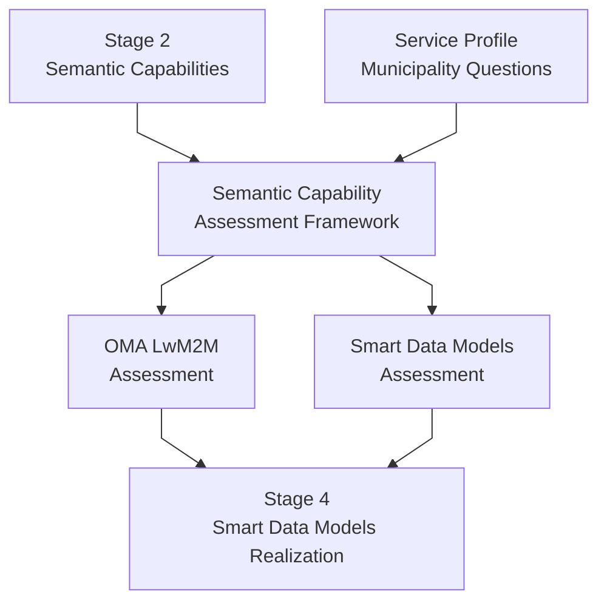

# {{ $doc.title }}

## Introduction

Stage 3 coordinates how the [semantic capabilities](/methodology/core-methodology/stage-2-semantic-capabilities.md) identified in Stage 2 may be realized across standards organizations, Smart Data Models ecosystems, and interoperability initiatives. The Digital Twin is the consumer of the methodology's output, not an ecosystem assessed here; its acceptance check is part of [Stage 4](/methodology/core-methodology/stage-4-smart-data-models-realization.md#checking-digital-twin-consumption).

At this stage, operational meaning has already been captured and the semantic capabilities are defined. The objective is not to force a single implementation model or define a centralized architecture, but to:
- assess which ecosystems can supply each capability,
- find candidate Smart Data Models and OMA objects for each Service Domain,
- record the gaps,
- and coordinate ecosystem contributions, leaving the decision on which ecosystem realizes each capability to Stage 4.

**Input:** the classified properties and their trustworthiness conditions from [Stage 2](/methodology/core-methodology/stage-2-semantic-capabilities.md), the entity types of the [Stage 1](/methodology/core-methodology/stage-1-operational-meaning.md#entity-sketch) entity sketch, and the municipality operational questions in each Service Profile.
**Output:** an ecosystem assessment report per ecosystem; [candidate](/methodology/glossary.md#candidate) Smart Data Models for the entity types; candidate OMA objects for the classified properties; the entity types for which no Smart Data Model fits; and the gaps found — the input to [Stage 4 — Smart Data Models Realization](/methodology/core-methodology/stage-4-smart-data-models-realization.md).

For the SIG's role and the methodology as a whole, see the [Methodology Overview](/methodology/core-methodology/methodology-overview.md).

---

# Purpose of Stage 3

Stage 3 exists to answer the following questions:

- Which ecosystem participants can contribute realization mechanisms?
- Which standards or interoperability assets already exist?
- What semantic gaps remain unresolved?
- Which Smart Data Models and OMA objects are candidates for the entity types and properties of each Service Domain?
- Can each ecosystem carry each capability consistently?
- How can semantic consistency be preserved across ecosystem contributions?

---

# Why Ecosystem Coordination Matters

A single municipality use case may involve IoT devices, operational platforms, semantic integration layers, Digital Twin systems, interoperability standards, and multiple organizational stakeholders. No single standards organization or ecosystem usually owns all these layers, so municipality operational meaning, semantic interoperability concerns, and ecosystem realization approaches have to be analyzed and aligned jointly.

---

# Ecosystem Collaboration Model

Different ecosystem participants contribute different forms of expertise. Only some of them are assessed with the Semantic Capability Assessment Framework; the others contribute without an assessment report.

| Participant | Example Contributions | Role in Stage 3 |
|---|---|---|
| Municipalities | Operational realities, pain points, service objectives | Source of operational meaning |
| OMA / LwM2M contributors | Device interoperability standards and objects | Assessed |
| Smart Data Model ecosystems | Semantic integration structures and practices | Assessed |
| FIWARE | Smart Data Model practices | Contributor |
| Universities | Semantic analysis and research support | Contributor |
| Vendors | Operational implementation realities | Contributor |
| Other SDOs and alliances | Domain-specific interoperability assets | Contributor; may be assessed later |

---

# Assessing Ecosystems

Each ecosystem is assessed with the [Semantic Capability Assessment Framework](/methodology/assessment-frameworks/semantic-capability-assessment.md) (SCAF), which asks the same questions of every ecosystem for every semantic capability. Each ecosystem's answers are recorded in its own assessment report, listed in the SCAF's [Ecosystem Assessments](/methodology/assessment-frameworks/semantic-capability-assessment.md#ecosystem-assessments) table.

Assessment activities typically include identifying compatible interoperability assets, identifying semantic gaps, evaluating contextual metadata requirements, identifying validation implications, and assessing interoperability consistency.

## Finding Candidate Models and Objects

For each Service Domain, the assessments also look for concrete candidates:
- **Smart Data Models** whose entity types correspond to the entity types in the Stage 1 [entity sketch](/methodology/core-methodology/stage-1-operational-meaning.md#entity-sketch). Properties a model defines but the municipality did not mention go back to Stage 1 as questions for the municipality; properties the municipality needs but no model defines are recorded as gaps. When no model corresponds to an entity type at all, the entity type is recorded as a candidate for a new Smart Data Model; it is neither dropped nor forced into a model that describes something else.
- **OMA objects** that can supply each observable property under the trustworthiness conditions identified in Stage 2. When no object meets a condition, the condition is re-checked in Stage 2 before it is recorded as a gap.

A candidate is not yet a mapping. Checking that the OMA objects can feed the Smart Data Models, and refining the models where they cannot, is Stage 4.

Bringing the assessment results together, and mapping each Service Domain onto Smart Data Models and ontologies, is the work of [Stage 4](/methodology/core-methodology/stage-4-smart-data-models-realization.md).

---

# Validation and Interoperability Considerations

Stage 3 validates each ecosystem on its own: whether it can carry each capability consistently, considering semantic consistency, contextual completeness, measurement comparability, and provenance integrity.

The end-to-end validation — whether operational meaning survived realization, and whether a Digital Twin consuming the Smart City Profile can answer the municipality operational questions — belongs to [Stage 4](/methodology/core-methodology/stage-4-smart-data-models-realization.md#checking-digital-twin-consumption). Validation approaches may evolve through ecosystem collaboration and implementation experience.

---

# Common Stage 3 Pitfalls

## Semantic Drift
Ecosystem realization approaches must preserve the operational meaning identified during earlier stages.

## Platform-Centric Thinking
The methodology should remain interoperability-oriented rather than tied to a single platform or ecosystem implementation.

## Ignoring Municipality Intent
Ecosystem realization must remain aligned with the original municipality operational objectives.

Premature architecture lock-in and over-standardization are covered by [Meaning Before Standards](/methodology/core-methodology/methodology-overview.md#meaning-before-standards).

---

# Public Street Lighting Example

The [Public Street Lighting walkthrough](/profiles/lighting/public-lighting-walkthrough.md) (section *Stage 3 — Standards & Ecosystem Mapping*) shows this stage in practice, and the [OMA Semantic Capability Assessment](/methodology/assessment-frameworks/oma-capability-assessment.md) records the detailed OMA findings for Public Lighting.
