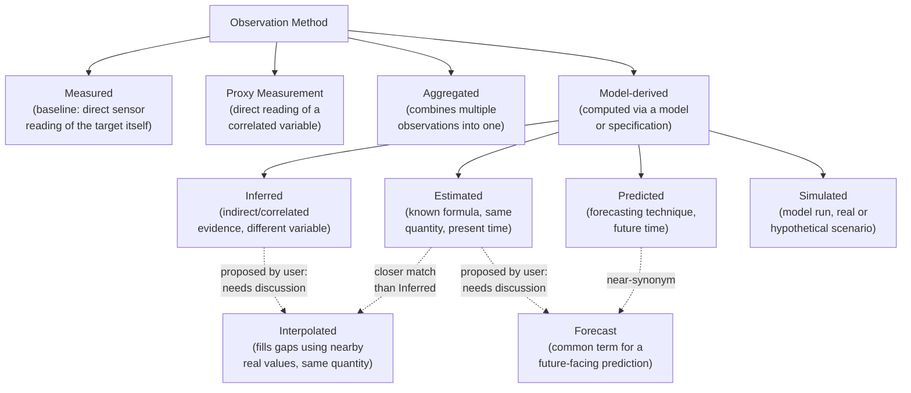
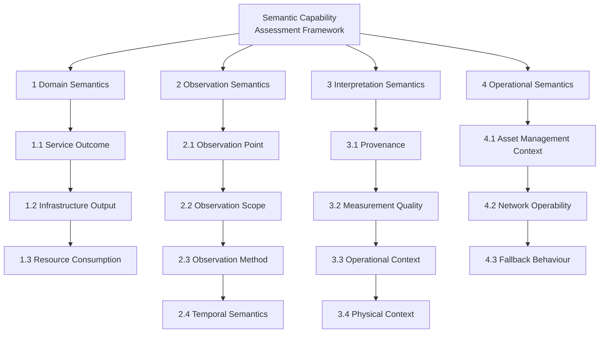

# {{ $doc.title }}

This glossary collects the terms defined or consistently used across the Smart Cities SIG methodology documents, in alphabetical order, with one initial meaning per term.

It is the single place where these terms are defined; other pages link here instead of redefining them. A new term added before SIG review is marked *Status: Proposed* until the SIG accepts it. An *Avoid* line lists earlier or ambiguous wording that should not be used for the term.

---

### Action / Event

In the Stage 1 entity sketch, an **action** is invoked on an entity or triggered by it (for example, switching a streetlight on or dimming it); an **event** is emitted by an entity (for example, a lamp failure). Both are recorded in the municipality's words. How they are represented (NGSI-LD, W3C WoT Thing Model) is an open question for Stage 4.

### Aggregated

An Observation Method value describing a production technique: a reported number obtained by mathematically combining multiple underlying observations into one, rather than reporting a single directly sensed reading. The dimension being combined — across assets/locations vs. across time — is separately captured by Observation Scope and Temporal Semantics respectively; "Aggregated" here labels the computation itself.

### Asset Management Context

Ownership, responsible management, contracts, warranties, maintenance history, useful life, and lifecycle information for an infrastructure asset — not a measurement, but the administrative context around it.

### Capability Assessment Matrix

Earlier part of the Semantic Capability Assessment Framework: a table that lined each of the 14 semantic capabilities up against the questions posed to OMA, Smart Data Models, and Digital Twins, showing where each ecosystem did or didn't preserve that capability. It was removed from the framework because its OMA column had come to disagree with the OMA report. Assessment results are now recorded only in each Ecosystem Assessment; do not use this term for a place where results are recorded.

### Companion Capability

A semantic capability that a sub-observation still carries for context in addition to its one Primary Capability — for example, a sub-observation primarily about Observation Point may carry Provenance as a companion when the same device name also identifies who reported it.

### Contextual Metadata

Environmental and operational information (weather, vegetation, humidity, shadows, schedules, maintenance zones, etc.) that must stay attached to a measurement for it to be interpreted correctly. Losing this metadata during abstraction is treated as a recurring methodology risk (e.g., "an aggregated value without scope may become ambiguous"). It is not itself a semantic capability: the capabilities that carry it are Operational Context and Physical Context.

### Convergence

The Stage 4 work of reconciling the independent Ecosystem Assessments: comparing results per semantic capability, matching OMA objects to Smart Data Models, assigning realization responsibility, recording Residual Gaps, and expressing the result as Smart Data Models while keeping each decision traceable to the municipality's operational meaning.

### Digital Twin

The software representation of municipal infrastructure/services that ultimately consumes operational data to support monitoring, analytics, simulation, and operational decision-making. The methodology treats a Digital Twin as needing contextual information, semantic consistency, provenance awareness, and interoperability reliability — not just raw telemetry — to be trustworthy. In the methodology the Digital Twin is the consumer of the output, not an ecosystem assessed in Stage 3: the Digital Twin questions of the Semantic Capability Assessment Framework are the Stage 4 acceptance check of a Smart City Profile.

### Domain Semantics

One of the four semantic categories. Describes what the municipality ultimately cares about: the service delivered, the infrastructure providing it, and the resources it consumes. Groups the Service Outcome, Infrastructure Output, and Resource Consumption capabilities.

### Ecosystem Assessment

A report that evaluates one ecosystem (for example, OMA LwM2M or Smart Data Models) against the Semantic Capability Assessment Framework. It is the only place where that ecosystem's findings are recorded, and it is an input to Stage 4.
_Avoid_: Capability Assessment Matrix (as a place results are recorded)

### Ecosystem Coordination / Ecosystem Realization

The Stage 3 activity of aligning how different ecosystem participants (standards bodies, Smart Data Model communities, Digital Twin platforms, vendors, universities) realize the semantic capabilities identified in Stage 2 — without the SIG forcing a single implementation model or architecture. Stage 4 then reconciles the resulting realization approaches (see Convergence).

### Entity Sketch

The Stage 1 summary of the entity types that the user stories mention (for example, a streetlight, a street segment, or a park zone), each with its properties, actions, and events, still in the municipality's own words. It is not a data model and uses no standard names. Stage 2 applies the semantic capabilities to each observable property in it; Stage 3 looks for candidate Smart Data Models for its entity types.

The sketch also records the relationships the municipality states between entities (for example, a circuit feeds a luminaire, a tree stands near a luminaire), labelled Proposed until the department confirms them.
_Avoid_: entity model, data model (for the Stage 1 output)

### Estimated

An Observation Method value: a figure calculated from other measured quantities of the same system using a known formula or specification, rather than sensed directly (e.g. computing illuminance from luminaire specifications and geometry instead of metering it at the road surface).

### Fallback Behaviour

The autonomous behavior infrastructure exhibits when communication or supervisory control is lost — local schedules, safe/emergency operating modes, manual override, local decision-making.

### FIWARE

An open-source platform ecosystem referenced in the methodology as a contributor of digital platform and Digital Twin integration capabilities, and of Smart Data Model practices.

### Inferred

An Observation Method value: a figure deduced from indirect or correlated evidence rather than a direct calculation targeting the quantity itself (e.g. inferring soil moisture from rainfall history and an evapotranspiration model).

### Infrastructure Output

The physical behavior or output produced by infrastructure assets while delivering a service, distinguished from whether the service objective was actually achieved (e.g., lumens emitted, pump flow rate, valve opening percentage).
_Avoid_: Infrastructure Behavior (as the capability name)

### Interoperability

The ability of systems, standards, and data models from different ecosystems to exchange and correctly interpret municipality operational information without losing semantic meaning — the central objective the SIG methodology is built to support.

### Interoperability Profile

A named set of semantic requirements that an ecosystem makes mandatory for a Service Domain — for example, an OMA Public Lighting Interoperability Profile that makes timestamp, unit, and quality Resources required. Not to be confused with a Service Profile.
_Avoid_: profile (unqualified), candidate profile concept

### Interpretation Semantics

One of the four semantic categories. Describes how observations should be understood and trusted, via their provenance, quality, and context. Groups the Provenance, Measurement Quality, Operational Context, and Physical Context capabilities. Together these describe the trustworthiness conditions of an observation, following the Trustworthiness viewpoint of ISO/IEC 30141.

### ISO/IEC 30141

The ISO/IEC international standard for an IoT Reference Architecture. The Semantic Capability Assessment Framework explicitly aligns its viewpoint-and-view structure with Clause 6 of ISO/IEC 30141:2024.

### LwM2M (Lightweight Machine to Machine)

OMA's device-management/data-model protocol for constrained IoT devices, referenced via "OMA LwM2M Objects and Resources" as the mechanism evaluated for device interoperability.

### Meaning Before Standards

The central principle of the methodology: operational meaning is captured before any standard, schema, or architecture is chosen. Standard vocabulary therefore enters only in Stage 3. Stated once in the Methodology Overview and applied in every stage.
_Avoid_: premature standardization (as a separately defined idea per stage)

### Measured

An Observation Method value describing the baseline production technique against which the other methods (Estimated, Inferred, Predicted, Simulated, Model-derived, Aggregated, Proxy Measurement) are defined by contrast: a value obtained by directly sensing the target quantity itself, in the moment, without mathematical transformation, modeling, forecasting, or substitution by a correlated variable.

### Measurement Quality

The accuracy, precision, reliability, completeness, and uncertainty of an observation.

### Methodology Worksheet

The practical fill-in template for analysing a Service Domain during Stages 1 and 2. It starts from user stories and the entity sketch, and each of its steps names the semantic capabilities it feeds; it references the capabilities rather than redefining them. Formerly the "Methodology Pattern".

### Model-derived

An Observation Method value: a figure produced by applying a computational or analytical model to input data, as opposed to a raw sensor reading (the source poses this as a three-way split: "Is this observation based on a sensor, a model, or historical data?").

### Municipality Operational Question

A service-specific question a municipality expects a Digital Twin to answer (for example, whether a street meets its minimum lighting level). Each is kept in the relevant Service Profile and keyed by semantic capability; the Semantic Capability Assessment Framework uses them as its first perspective.

In Stage 1 each user story yields at least one such question, written in the department's own words and with no capability label; Stage 2 adds the capability key.

### Municipality Operational Reality

The starting point of the methodology's overall model — the actual, unprocessed operational conditions, needs, and constraints of a municipality's service, before any semantic or interoperability analysis is applied.

### Need

A statement of what a municipal department wants, as the municipality gave it (for example, one row of a workshop table). It is never edited; one need usually gives several user stories, a requirement, or both.
_Avoid_: calling a need a user story, theme

### Network Operability

Network availability, connectivity, latency, packet loss, signal quality, and communication reliability — i.e., whether an asset is reachable right now.

### Observation

The raw, possibly compound fact as originally stated about a municipal service, before being split by capability.

### Observation Method

How an observation is obtained — measured, estimated, predicted, simulated, aggregated across assets, or a proxy — as distinct from what it represents or when it was taken.

### Observation Point

Where an observation originates within the IoT system and the municipal environment, and how that affects its use and interpretation — a position, not an actor.

### Observation Scope

Which part of the system or municipality an observation covers, including values that combine multiple assets or locations into one number (space/asset aggregation, as opposed to time aggregation).

### Observation Semantics

One of the four semantic categories. Describes how operational information is observed: where it originates, what it represents, how it's obtained, and its temporal characteristics. Groups the Observation Point, Observation Scope, Observation Method, and Temporal Semantics capabilities.

### OMA (Open Mobile Alliance)

The standards organization the SIG works with for device interoperability standards (see LwM2M); named as the SIG's Stage 3 standards partner.

### OMA Registry Capability Classification

The resource-by-resource classification of the OMA LwM2M Registry against the 14 semantic capabilities, showing which capabilities OMA can supply today and where the gaps are. It is evidence for the OMA Ecosystem Assessment, not a definition of the capabilities.
_Avoid_: Semantic Capability Reference (for this page)

### Operational Context

Dynamic, situational operating conditions (weather, traffic, occupancy, seasonality) that affect a service and its observations in the moment — as distinct from Physical Context, which is static.
_Avoid_: Contextual Abstraction, Contextual Metadata (as a capability name)

### Operational Evidence

The statements a municipal respondent makes during Stage 1 that explain the user stories and the entity sketch, each kept in the respondent's words and linked to the stories and entity-sketch rows it explains. One statement is an *evidence item*, of one of five kinds: an objective (how the department knows things are going well), a pain point (what goes wrong because of how something is known today), a distinction (two things that sound alike but differ), a context (a circumstance that changes how something is read, and how often it changes), or held elsewhere (information another department or a manufacturer holds). Stage 2 reads the evidence linked to each property when classifying it.
_Avoid_: summary, notes, findings, observations

### Operational Meaning

The real operational intent, objectives, pain points, and contextual dependencies behind a municipality's requirements, understood before any standards mapping is attempted. This is the output of Stage 1.

### Operational Semantic Translation Model

The overall model describing how municipality operational realities are transformed through the four stages — operational meaning, semantic capabilities, standards and ecosystem mapping, and Smart Data Models realization — into Digital Twin-consumable outputs. The work is not strictly sequential: a later stage can send a question back to an earlier one.

### Operational Semantics

One of the four semantic categories. Describes how infrastructure is operated and managed throughout its lifecycle: responsibility, communications, and resilience. Groups the Asset Management Context, Network Operability, and Fallback Behaviour capabilities.

### Pain Point (Operational Pain Point)

A specific operational difficulty, inconsistency, or piece of unreliable/incomparable information identified while analyzing a municipality's service during Stage 1.

### Physical Context

The static, structural physical environment (buildings, trees, terrain, orientation, shadows, surface materials) and its impact on service outcomes — as distinct from Operational Context, which is dynamic.
_Avoid_: Contextual Abstraction, Contextual Metadata (as a capability name)

### Predicted

An Observation Method value: a figure describing a future state or time period, produced by a forecasting technique (e.g. water demand predicted from weather forecasts). Distinguished from the other methods mainly by temporal direction rather than production technique — a prediction may itself be model-derived or simulated.

### Primary Capability

The one semantic capability a sub-observation is fundamentally about, after a compound observation has been split so each resulting piece maps to exactly one capability.

### Proof of Concept

A program activity outside the four methodology stages that validates a Smart City Profile in a real deployment and feeds the lessons back into Stage 1. It is the final output of the work and is not numbered as a stage.
_Avoid_: Stage 5, Stage 6

### Property Fact

One of the eight things Stage 1 establishes about each property in the Entity Sketch: (a) which thing it belongs to, (b) its role — what people experience, what the equipment does, what it costs, a circumstance, or a record, (c) where it is known, (d) how it is known today, by whom, how often and how old, (e) what makes it good or bad and who sets that, (f) the circumstances that change how it is read, (g) what is decided or done with it, and (h) what goes wrong today because of how it is known. A property is complete when every property fact is answered or routed to a named unit as an open question. Operational Evidence explains the property facts; it does not replace them.
_Avoid_: property profile, card, evidence

### Provenance

The source of an observation or piece of operational information — which system or actor reported or supplied it (device sensor, control cabinet, weather service, human operator, Digital Twin, predictive model, etc.) — a source identity, not a location.

### Proxy Measurement

An Observation Method value: a different quantity, measured directly, used as a stand-in for the quantity actually being reported because the target isn't directly measurable or economical to measure (e.g. luminaire input current reported as a proxy for light output). Unlike Estimated, Inferred, Predicted, Simulated, or Model-derived, this is still a direct sensor reading — just of a correlated variable.

### Requirement

A need that says how the system should be built, which means to use, how data should be handled, or what systems must exchange, rather than what someone needs to know or do about a thing. It is not written as a user story, but it is always traced to the user stories whose operational need it serves. Stage 1 keeps requirements in a register, each linked to the user stories or entity sketch rows it relates to; Stage 2 receives the register without classifying it (how Stage 2 should treat requirements is [OI-019](https://github.com/smartcities-sig/sig-wg/blob/main/technical/open-issues.md#oi-019--treating-stage-1-requirements-in-stage-2)).
_Avoid_: technical story, non-functional story

### Residual Gap

A semantic capability that no assessed ecosystem contribution covers. Stage 4 records it together with the operational consequence of leaving it unrealized; it is never silently dropped.

### Resource Consumption

The resources (energy, water, fuel, battery, active/reactive power, voltage, frequency) consumed by infrastructure to deliver a service.

### Reusable Interoperability Abstraction

Earlier name for the output of Stage 2: a semantically meaningful concept — not yet a standards object, schema, API, or implementation model — that emerges from operational analysis, preserves operational meaning, and may apply across multiple municipality domains.

### SDO (Standards Development Organization)

Generic term for a body that develops and maintains technical standards; used in Stage 3 as "Other SDOs and alliances" to denote standards bodies beyond OMA and FIWARE that may contribute domain-specific interoperability assets.

### Semantic Capability

One dimension of meaning needed to interpret municipal operational data correctly — what it represents, where it comes from, how much it can be trusted, or how it should be acted on. The SIG defines 14 of these, grouped into 4 semantic categories. They are the output of Stage 2.
_Avoid_: reusable interoperability abstraction, abstraction type, `ServiceOutcomeMeasurement`-style abstraction names

### Semantic Capability Assessment Framework (SCAF)

The technology-neutral framework, built on the 14 semantic capabilities, that lets standards organizations, Smart Data Model communities, and Digital Twin initiatives evaluate whether their specifications preserve the semantic capabilities municipalities need — assessed from four perspectives: municipality operational questions, questions for OMA, questions for Smart Data Models, and Digital Twin questions. It is the assessment method of Stage 3 and contains questions only: the capability definitions live in Stage 2, the service-specific municipality operational questions in each Service Profile, and the results in the Ecosystem Assessments.

### Semantic Category

One of the four groupings of the 14 semantic capabilities — Domain, Observation, Interpretation, and Operational Semantics — following the viewpoint-and-view structure of Clause 6 of ISO/IEC 30141:2024. "Domain Semantics" names a category and does not refer to a Service Domain. Formerly called "semantic domain".
_Avoid_: semantic domain, domain (for the grouping)

### Semantic Distinction

A meaningful difference between two measurements or operational concepts that appear technically related but represent different operational meanings (e.g., service outcome vs. infrastructure output, measured vs. inferred values). Identifying these is a core Stage 1 activity.

### Semantic Domain

Earlier name for the four top-level groupings (Domain, Observation, Interpretation, and Operational Semantics) of the 14 semantic capabilities. Renamed because "domain" clashed with Service Domain.

### Semantic Drift

A named Stage 3 pitfall in which ecosystem realization approaches fail to preserve the operational meaning identified during earlier stages, so the original municipality intent is lost as concepts get implemented.

### Service Domain

A municipal service area analysed by the methodology, such as Public Lighting or Water Management & Irrigation. Not to be confused with Domain Semantics, which is a semantic category.
_Avoid_: domain (unqualified), use case, Smart Water Metering (for the current water scope)

### Service Outcome

The real-world outcome a municipality intends to achieve, independent of how the underlying infrastructure behaves — the "so what," not the infrastructure's own behavior or its cost to produce.

### Service Profile

Everything the SIG produces for one Service Domain — its walkthrough, municipality operational questions, and OMA-to-Smart-Data-Models mappings — kept under `profiles/<domain>/`. It is the working material, not the final deliverable. Not to be confused with an Interoperability Profile, or with the Smart City Profile, which is the Stage 4 deliverable for the same Service Domain.
_Avoid_: profile (unqualified)

### Simulated

An Observation Method value: a figure produced by running a computational or physical model of the system to reproduce a scenario — real, hypothetical, or counterfactual — rather than an in-the-moment sensor reading.

### Smart City Profile

The SIG's implementation-ready deliverable for one Service Domain, produced in Stage 4: the converged Smart Data Model realization (including new models drafted where none fitted), a catalogue of the OMA objects that can feed it, the required metadata, and the recorded Residual Gaps. It is checked against the Digital Twin questions of the Semantic Capability Assessment Framework, may reference ecosystem Interoperability Profiles, and is validated in a Proof of Concept. Not to be confused with a Service Profile, which is the working material for the same Service Domain.
_Avoid_: profile (unqualified), Service Profile (for the deliverable)

### Smart Data Model

A semantically enriched interoperability structure — not treated as an isolated technical schema — that combines telemetry, metadata, operational context, and semantic relationships so information stays interoperable and Digital Twin-consumable across municipal domains. The catalogue originated in FIWARE and is the main carrier of municipality context into Digital Twins; Stage 4 expresses the realized capabilities as Smart Data Models.

### Smart Data Object

A term used in earlier versions alongside "Smart Data Model" ("Smart Data Object ecosystems," "Smart Data Object realization") in the same sense.

### Stage 1 — Operational Meaning

The first methodology stage. Extracts a municipality's real operational objectives, pain points, semantic distinctions, and contextual dependencies from operational material, interviews, and workshops, while deliberately avoiding premature standards or schema mapping. It starts from user stories and summarizes them in an entity sketch.

### Stage 2 — Semantic Capabilities

The second methodology stage. Generalizes Stage 1's operational findings into the taxonomy of 14 semantic capabilities, grouped into 4 semantic categories, independent of any standard. The capabilities are applied to each observable property in the Stage 1 entity sketch. Formerly named "Reusable Interoperability Abstractions".
_Avoid_: Reusable Interoperability Abstractions (as a stage name)

### Stage 3 — Standards & Ecosystem Mapping

The third methodology stage. Assesses, ecosystem by ecosystem, how well existing specifications can supply each semantic capability, using the Semantic Capability Assessment Framework. It also finds candidate Smart Data Models for the entity types in the Stage 1 entity sketch and candidate OMA objects for their observable properties. Its outputs — the Ecosystem Assessments and coordinated realization approaches — are the input to Stage 4.

### Stage 4 — Smart Data Models Realization

The fourth methodology stage. Reconciles the independent Ecosystem Assessments from Stage 3 into Smart Data Models a Digital Twin can consume, produces a catalogue of the OMA objects that can feed them, and records the Residual Gaps; together these form the Smart City Profile for each Service Domain. It also covers mapping each Service Domain onto Smart Data Models and ontologies such as SAREF. Its detailed definition is still under development by the SIG.
_Avoid_: Stage 3 "mapping" (for the Smart Data Models and ontology mapping step)

### Sub-observation

What results from splitting a (possibly compound) observation so each piece has exactly one thing it's fundamentally about — its Primary Capability — though it may still carry Companion Capabilities for context.

### Temporal Semantics

The temporal characteristics of an observation and its use in KPIs and simulation — instantaneous, observation interval, sampling period, aggregation window, historical observation, forecast, prediction horizon.

### Trustworthiness Conditions

The conditions under which an observation can be relied on — its provenance, quality, and operational and physical context. Used as a descriptive label for the Interpretation Semantics category, following the Trustworthiness viewpoint of ISO/IEC 30141.

### User Story

A Stage 1 statement of a need related to a municipal service, in the words of whoever has that need — the people who run the service, and also other roles such as citizens or technology providers — following a fixed pattern: a type of user, an action, the conditions, and the benefit (for example, "<type of user> want to <action> under <conditions> so that <benefit>"). A good story is specific, measurable, achievable, relevant, and testable. The benefit points to the Service Outcome. User stories are analysed to build the Entity Sketch.
