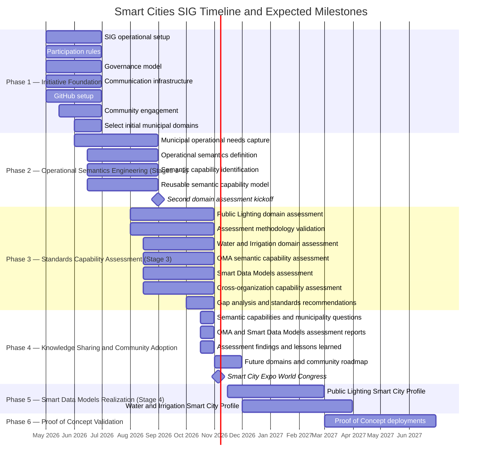

# {{ $doc.title }}

This document defines the high-level execution roadmap, milestones, and expected deliverables for the Smart Cities SIG PoC initiative between May 2026 and the Proof of Concept phase in 2027. Phases 2, 3 and 5 follow the [four stages of the methodology](/methodology/core-methodology/methodology-overview.md); dates after November 2026 are indicative until the group agrees them.

The purpose of this plan is to provide participants, contributors, and future stakeholders with a clear understanding of:
- the planned phases of execution,
- major objectives and deliverables,
- expected validation milestones,
- and the timeline leading to the Smart City Expo World Congress 2026 showcase.

The roadmap is intentionally lightweight and iterative, reflecting the Proof of Concept nature of the initiative while maintaining focus on interoperability, reusable outputs, and ecosystem collaboration.

### Phase Summary and Key Milestones

<table>
  <caption><strong>Phase Summary and Key Milestones</strong></caption>
  <thead>
    <tr>
      <th>Phase</th>
      <th>Timeline</th>
      <th>Main Objective</th>
    </tr>
  </thead>
  <tbody>
    <tr>
      <td>Phase 1 — Initiative Foundation</td>
      <td>May–June 2026</td>
      <td>Establish the governance, participation model, collaboration infrastructure, community, and initial municipal domains for the Smart Cities SIG.</td>
    </tr>
    <tr>
      <td>Phase 2 — Operational Semantics Engineering</td>
      <td>June–August 2026</td>
      <td>Capture municipal operational needs, define their operational semantics, and organize them into reusable semantic capabilities.</td>
    </tr>
    <tr>
      <td>Phase 3 — Standards Capability Assessment</td>
      <td>August–October 2026</td>
      <td>Apply and validate the methodology through domain and cross-standard assessments, identify interoperability gaps, and formulate recommendations for standards organizations.</td>
    </tr>
    <tr>
      <td>Phase 4 — Knowledge Sharing and Community Adoption</td>
      <td>October–November 2026</td>
      <td>Publish the semantic capabilities, the municipality questions, the OMA and Smart Data Models assessment reports, findings, and recommendations, and present the initiative at Smart City Expo World Congress.</td>
    </tr>
    <tr>
      <td>Phase 5 — Smart Data Models Realization</td>
      <td>November 2026–Q1 2027 (indicative)</td>
      <td>Consolidate the Stage 3 results into a Smart City Profile for each Service Domain, checked against the Digital Twin questions, with residual gaps recorded.</td>
    </tr>
    <tr>
      <td>Phase 6 — Proof of Concept Validation</td>
      <td>2027 (indicative)</td>
      <td>Validate the Smart City Profiles in real deployments and feed the lessons back into Stage 1.</td>
    </tr>
  </tbody>
</table>

## Status (31 October 2026)

What has been built so far and what is still missing, stage by stage. This table is updated as the work progresses.

| Stage | Built so far | Still missing |
|---|---|---|
| 1 — Operational Meaning | [Stage 1 method](/methodology/core-methodology/stage-1-operational-meaning.md) and [worksheet](/methodology/core-methodology/methodology-worksheet.md); Stage 1 sections in the [lighting](/profiles/lighting/public-lighting-walkthrough.md) and [water](/profiles/water/public-watering-walkthrough.md) walkthroughs; Madrid workshops held | User stories and entity sketches in the walkthroughs, from the Madrid workshop output; the user-story pattern |
| 2 — Semantic Capabilities | The [14 semantic capabilities](/methodology/core-methodology/stage-2-semantic-capabilities.md) in 4 categories; municipality questions for [lighting](/profiles/lighting/municipality-questions.md) and [water](/profiles/water/municipality-questions.md) | The group decision on how Operational Semantics applies to the entity sketch |
| 3 — Standards & Ecosystem Mapping | The [assessment framework](/methodology/assessment-frameworks/semantic-capability-assessment.md); the [OMA assessment](/methodology/assessment-frameworks/oma-capability-assessment.md) and [registry classification](/methodology/assessment-frameworks/oma-registry-capability-classification.md); the [Smart Data Models assessment](/methodology/assessment-frameworks/sdm-capability-assessment.md) | A Smart Data Models assessment as detailed as the OMA one; assessments of other standards organizations |
| 4 — Smart Data Models Realization | The [Stage 4 method](/methodology/core-methodology/stage-4-smart-data-models-realization.md) (draft); early OMA – Smart Data Models mappings for [lighting](/profiles/lighting/mappings/oma-smart-data-models-mapping-lighting.md) and [water](/profiles/water/mappings/oma-smart-data-models-mapping-water.md) | Answers to the Stage 4 open questions; the Smart City Profile for each Service Domain |
| Proof of Concept | — | Everything: planned for Phase 6 |
